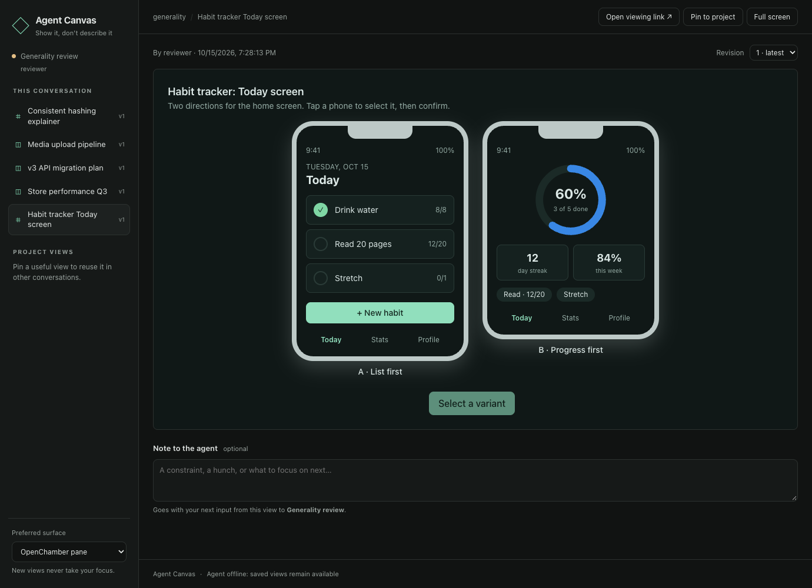
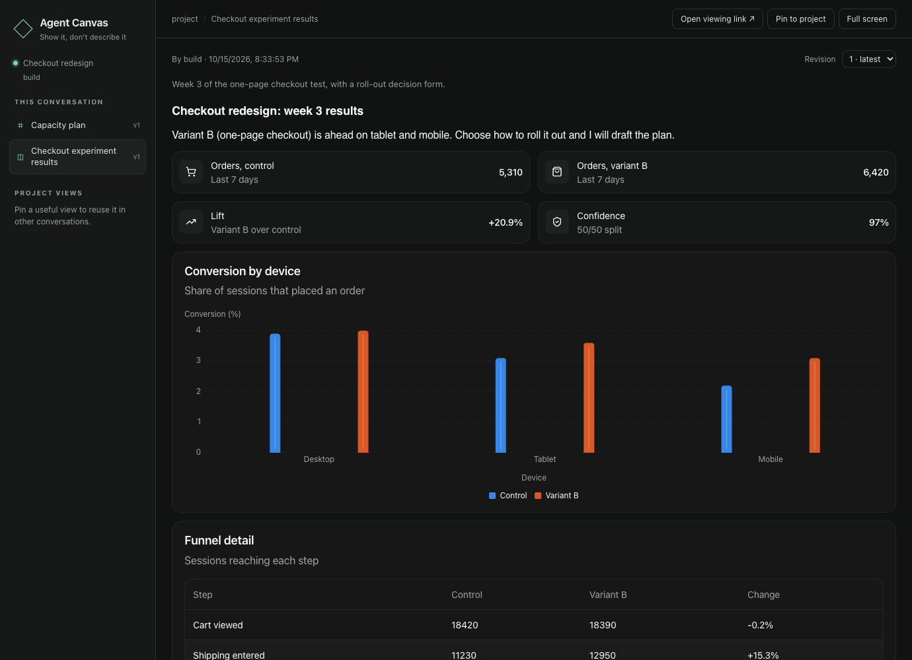
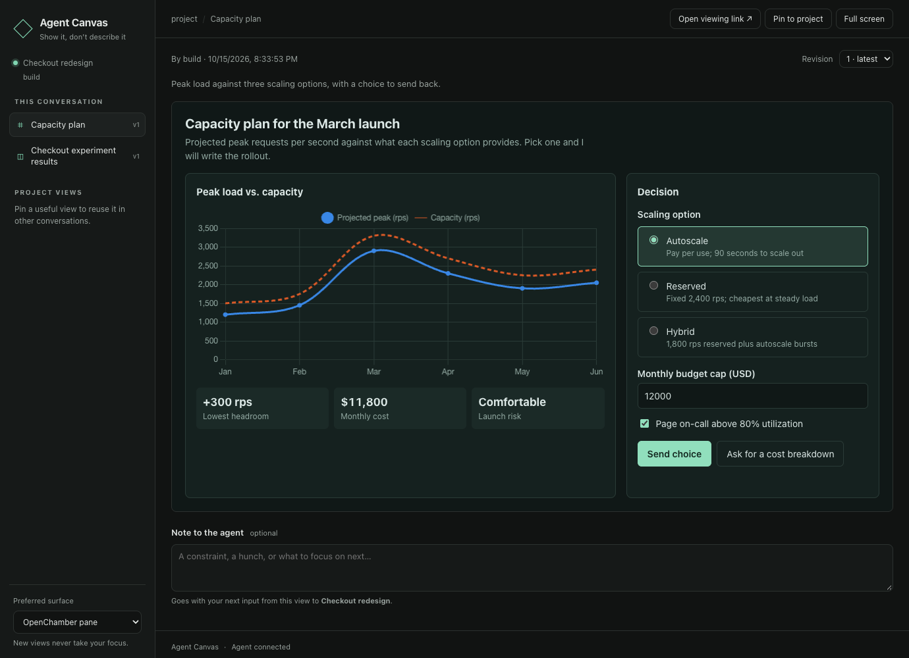
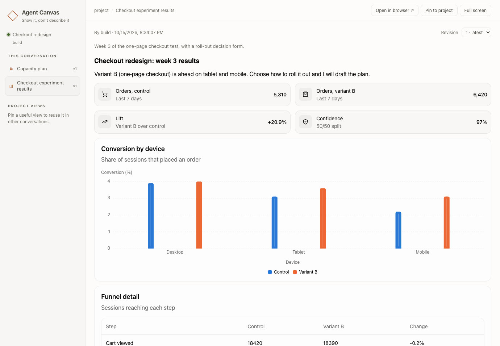

# Agent Canvas

A visual surface for [OpenCode](https://opencode.ai) agents. An agent can put in front of you anything it would otherwise describe in words: an interface mockup, a chart of real data, a table, a form, a diagram, a comparison, a simulation. You see it in an [OpenChamber](https://github.com/openchamber/openchamber) pane, a desktop browser, or on your phone, and what you click, choose or type in it goes back to the same conversation as a message the agent can act on.



## Why it exists

Chat is a poor medium for anything with shape: layouts, data, systems, options with tradeoffs. The agent can only describe them, and you can only type back. Agent Canvas gives the agent a place to show, and gives you controls to answer with. It had to meet four requirements:

- **Show anything.** Standard components for data and decisions, and full HTML for mockups, custom visuals and simulations.
- **Close the loop.** Input reaches the conversation that showed the view, once, with an honest status when it cannot be delivered.
- **Keep useful views.** Views are saved and revisioned, and a good one can be pinned for other conversations and agents to reuse and revise without overwriting each other.
- **Work wherever the agent runs.** Plain OpenCode, OpenChamber, a remote machine, or a phone on your tailnet, all showing the same saved views.

## What it gives agents

The OpenCode 2 plugin registers four tools and adds a short system note telling the agent they exist:

| Tool | What the agent does with it |
| --- | --- |
| `canvas_guide` | Reads the reference for a format before first using it: `overview`, `openui` (the component reference) or `html` (the page bridge, theme variables and bundled libraries). Loaded on demand, never pushed into every prompt. |
| `canvas_show` | Shows a new view or revises one (with `viewId` and `expectedRevision`). Returns the view id, revision and viewing link. Invalid content comes back as a tool error listing every problem, so the agent can repair it. |
| `canvas_read` | Lists the views this conversation and project can see, or reads one in full: its latest source, revision history, render errors that viewers reported, and recent input. |
| `canvas_pin` | Pins a view as a named project view that other conversations and agents in the project can find and revise. |

Two content formats sit behind one surface:

- **OpenUI** (`format: "openui"`): the agent writes [OpenUI Lang](https://github.com/thesysdev/openui) against OpenUI's standard component library (layout, cards, tables, charts, forms, tabs, steps, tags) plus a Canvas `Diagram` for directed graphs. Short to write, always on theme, and buttons and forms send their values with no code.
- **HTML** (`format: "html"`): one complete, self-contained document, rendered in a locked-down sandbox. For a mockup of a specific screen, custom SVG or canvas drawing, animation, or anything components cannot express. Tailwind, Chart.js, D3 and Mermaid are bundled; a small bridge (`window.canvas`) sends the user's input back.





In practice, this gives an agent:

- **Structured input back.** A button sends its action; a form sends every field as data; an HTML page calls `canvas.send(action, data)`. Input arrives as an ordinary user message starting with `[Agent Canvas]` that names the view, revision, action and data, plus any note you typed.
- **Memory across sessions.** Each conversation keeps the revision it showed. Project views can be revised by any agent in the project, with `expectedRevision` conflicts instead of silent overwrites.
- **Repairable errors.** Validation errors, and render errors your viewer hits (a script error, an image that cannot load), reach the agent through `canvas_read`.
- **No interruptions.** The agent can present proactively. Nothing opens windows or steals focus.
- **No extra model.** The conversation's own model writes every view. Agent Canvas has no generation provider and no API key.

## Built on OpenUI

The OpenUI format is [OpenUI](https://github.com/thesysdev/openui) from Thesys (MIT): the 82-component standard library from `@openuidev/react-ui`, rendered with `@openuidev/react-lang`, plus Canvas's own `Diagram`. Agent Canvas uses OpenUI for three reasons:

- **Compact.** A dashboard or form in OpenUI Lang is a fraction of the size of the same thing in HTML, so it costs the agent fewer tokens.
- **Declarative.** The model writes no code, every view matches the theme, and buttons and forms send their values without any wiring.
- **Checkable.** OpenUI's parser runs in the Canvas service, so mistakes come back to the agent as specific, repairable errors before anything is saved.

The component reference the agent reads is generated from the library itself at build time, so it always matches what renders. The idea of a two-way generated interface comes from Thesys's [Open Intelligent UI](https://github.com/thesysdev/open-intelligent-ui) demo, where generated forms send a user's choices back to the model. Agent Canvas keeps that loop but plugs it into the agent and chat you already use, and adds sandboxed HTML for everything components can't express.

## Agent Canvas and OpenChamber's built-in visuals

OpenChamber 2.3.3 added a built-in `openchamber_render` tool: the agent writes a self-contained HTML page and OpenChamber shows it above the reply. If you use OpenChamber and want a one-off chart or mockup inside an answer, that works well.

Agent Canvas does a different job: two-way, saved, and available outside OpenChamber.

| | OpenChamber `openchamber_render` | Agent Canvas |
| --- | --- | --- |
| What the model writes | A complete HTML page | OpenUI Lang over themed components, or a sandboxed HTML page |
| Input back to the agent | None; the tool returns once the page is shown | Buttons, forms and page controls send structured input to the originating conversation, with delivery status |
| Lifetime | Stored with the reply that showed it | Saved with revisions; pinnable as project views that other conversations and agents can revise |
| Where it appears | Inline in OpenChamber chat | OpenChamber pane, any browser, phones over Tailscale |
| Needs OpenChamber | Yes | No; plain OpenCode works |

The two are independent and can be enabled together. If you would rather agents always use Canvas, turn off the built-in in **Settings → OpenChamber Tools**.

## Quick start

Requires Node.js 22 or newer and npm.

```sh
git clone https://github.com/batteryshark/agent-canvas.git
cd agent-canvas
npm ci
npm run check
```

The build produces two self-contained folders:

| Folder | Purpose |
| --- | --- |
| `dist/opencode` | OpenCode 2 plugin, local Canvas service, browser app, bundled libraries |
| `dist/openchamber` | OpenChamber extension: the pane app and its host service bridge |

No CDN, public hosting, or additional model provider is required.

### Try it without a model

```sh
npm start        # in one terminal: the Canvas service on 127.0.0.1:4317
npm run demo     # in another: prints viewing links
```

The demo shows an OpenUI dashboard and an HTML layout chooser, labeled "Interactive demo · no model calls", and answers each submission with a new revision.

### Install in OpenCode 2

Add the **absolute directory** of `dist/opencode` to `plugins` in your OpenCode configuration, keeping your other settings and plugins:

```json
{
  "plugins": ["file:///absolute/path/to/agent-canvas/dist/opencode"]
}
```

The global configuration is `~/.config/opencode/opencode.json` or `.jsonc` (`XDG_CONFIG_HOME` changes its parent directory); a project configuration also works. The plugin starts the Canvas service itself when needed. OpenCode 1 is not supported.

Then, in a new conversation:

> Put the test durations from the last run on the canvas, and give me a form to choose which suites to parallelize.

The agent replies with a viewing link.

### Install in OpenChamber

Requires OpenChamber 2.3.0 or newer, with the OpenCode plugin above installed on the backend that runs the conversation.

1. Open **Settings → Extensions**.
2. Add the absolute path to `dist/openchamber`.
3. Enable its local service when prompted.
4. Open **Agent Canvas** in the extension pane or page, then select a conversation.



The pane follows the selected directory and conversation, follows OpenChamber's theme, stores drafts in host storage, shows a badge, and opens links through OpenChamber's SDK. Its service reads the local Canvas connection file and passes only a session-scoped viewing credential to the pane.

Set **Preferred surface → Browser** to show a compact launcher in the pane instead. **Show here this time** displays the view once without changing that preference. OpenChamber doesn't load extension panes on mobile; use the agent's browser link there.

## Private remote and mobile access

Run the Canvas service beside OpenCode. On that machine, with Tailscale connected:

```sh
# Inspect existing routes first; choose an unused HTTPS port.
tailscale serve status
tailscale serve --bg --https=9443 http://127.0.0.1:4317

# Use the exact private URL printed by Tailscale.
node dist/opencode/canvas-service.cjs public-url --url https://HOST.TAILNET.ts.net:9443
```

Restart the Canvas service after changing its public URL. New viewing links then point to that private HTTPS origin and open from any device on the same tailnet, subject to your ACLs. This uses **Serve**, not public Funnel. Remove the route with `tailscale serve --https=9443 off`.

To launch the service manually:

```sh
node dist/opencode/canvas-service.cjs serve
```

It listens on `127.0.0.1:4317`. The plugin starts it automatically with `node`; set `AGENT_CANVAS_NODE` to an absolute Node path if `node` isn't on the host's PATH. For remote access, the service must keep running and the machine must stay awake.

If OpenChamber's server and OpenCode run on different machines, the pane's local service needs an explicit connection to the Canvas host. Its `connection.json` can hold the remote private HTTPS origin as `endpoint`, that Canvas host's agent token, and its private `publicUrl`. Keep that file private, and never put the agent token in pane settings or browser links. Without this bridge, the browser link returned by the remote agent still works.

## How views and input behave

- A conversation keeps showing the revision it last showed. Older revisions stay readable but cannot send.
- **Pin to project** gives a view a stable name and makes it available to other conversations in the same host and project. A project view another conversation wrote never opens on its own; you choose it from the sidebar.
- To revise, an agent calls `canvas_read` for the latest source, then `canvas_show` with the view id and `expectedRevision`. A conflicting write returns an error instead of overwriting.
- Input from a project view goes to the conversation you are viewing it in, never implicitly to the view's original author.
- An HTML page sends input or opens a link only while you are clicking or typing in it. Agent Canvas checks this in its own window, which the page cannot reach, so a page cannot act on its own on load or from a timer.
- Drafts (form entries, page state, your note) are saved per conversation, view and revision: in local storage in the browser, in host storage in the pane. They survive reloads, including a reload right after typing. Switching conversations mid-send cancels the send and keeps the input for its own conversation.
- Delivery states are explicit. A busy or unavailable agent leaves input **unsent** with a retry button. **Delivered** means OpenCode admitted the message, not that the work is done. A connection lost during admission, an expired worker lease, or a restart mid-delivery shows **uncertain**; check the conversation, because the service never repeats an ambiguous delivery.
- If the answer to a send is lost on the way back, Canvas resubmits the same input id, which the service admits at most once, instead of reporting a failure that invites a duplicate.
- A Canvas outage doesn't block ordinary OpenCode chat. After OpenCode restarts, the new plugin instance takes over its project's conversations within seconds; saved views stay readable meanwhile.
- After updating a local OpenChamber build, disable and re-enable Agent Canvas in **Settings → Extensions** to clear cached pane instances.

## What an agent writes

An OpenUI view is a few lines of OpenUI Lang:

```text
root = Stack([header, chart, form])
header = CardHeader("Checkout experiment", "Week 3 results")
chart = BarChart(["Desktop", "Tablet", "Mobile"], [Series("Control", [3.9, 3.1, 2.2]), Series("Variant B", [4.0, 3.6, 3.1])], "grouped", "Device", "Conversion (%)")
form = Form("rollout", Buttons([send]), [audience])
audience = FormControl("Audience", RadioGroup("audience", [RadioItem("Mobile only", "", "mobile"), RadioItem("All devices", "", "all")], "mobile"))
send = Button("Send decision", @ToAssistant("Roll out checkout variant B"), "primary")
```

An HTML view is a complete document. Its controls send through the bridge:

```html
<form data-canvas-action="Choose scaling option">
  <label><input type="radio" name="option" value="autoscale" checked> Autoscale</label>
  <label><input type="radio" name="option" value="reserved"> Reserved</label>
  <button type="submit">Send choice</button>
</form>
<script>
  chart.onclick = () => canvas.send('Explain March peak', { month: 'Mar' });
</script>
```

The agent receives:

````text
[Agent Canvas] Capacity plan (view 7c1e…, revision 3)
Action: Choose scaling option
Data:
```json
{ "option": "reserved" }
```
````

`canvas_guide` gives the agent the full reference for each format: every component signature and example for OpenUI, and the bridge, theme variables, libraries and sandbox rules for HTML.

## Data and security

Data lives in `~/.local/share/agent-canvas` by default; set `AGENT_CANVAS_HOME` to change it. `connection.json` holds a random agent credential, and `state.json` stores views, revisions, sessions, and delivery records. Both are created owner-only. Back them up together, and don't commit them. State from 0.1 is not migrated; the service tells you to move an old `state.json` aside.

Viewing links carry a session-scoped credential in the URL fragment. The browser moves it into tab-local session storage and strips it from the address bar. Anyone with the original link and network access can view that session's views and send input from them, so share links accordingly.

Agent-written HTML runs in an iframe with an opaque origin (`sandbox="allow-scripts"`) under a strict content security policy: no network requests, no access to Canvas credentials or the app's storage, no navigation of the app, no popups. One gap remains that no CSP closes: Chrome can prerender a `<link rel="prerender">` target, and WebRTC is not governed by CSP. Canvas rejects both when the agent shows a page, strips them when building it, and blocks the page from creating them at run time, but a page that builds a nested frame can still escape those run-time guards. Treat a view as able to make a request in principle, and keep secrets out of what agents put on the canvas.

Only the local plugin and the OpenChamber host service hold the broader agent credential. The HTTP service stays bound to loopback, rejects foreign browser origins, constrains viewer routes, and serves a fixed asset list under a restrictive content security policy. Tailscale provides the private HTTPS boundary.

## Status and limits

Version 0.2.0 is a hard-cutover rebuild of 0.1's fixed diagram document (see [PROJECT.md](PROJECT.md) and [docs/ARCHITECTURE.md](docs/ARCHITECTURE.md)). Tests cover the service, plugin, both formats, the sandbox, the OpenChamber pane under its real guest policy, mobile width, and a native OpenCode 2 run.

Not yet supported:

- Showing files the agent has, such as screenshots, other than as `data:` URLs within the source limits
- Synchronization between hosts: each Canvas service has its own JSON store
- Live merging of simultaneous edits (conflicts are reported, not merged)
- Deleting or unpinning views, and garbage collection of old ones

## Development

```sh
npm run check          # types, service, plugin, OpenUI and HTML tests, build
npm run test:browser   # installed Chrome: desktop, mobile, sandboxed pane, security probes
npm run test:native    # installed OpenCode 2, isolated data, local model fixture
```

Set `OPENCODE_BIN` to test another OpenCode 2 executable. The native test loads the built plugin into a real server, generates tool calls through a local HTTP model fixture, checks message admission and duplicate suppression, and exercises shared project revisions. It uses no account credentials and no existing conversations. Reports go to the ignored `.runtime/` folder; browser screenshots go to `test-results/`.

### Layout

| Path | Owns |
| --- | --- |
| `src/shared` | The contract, content checks (`openui-validate.ts`, `html-check.ts`), the HTML guide, demo content |
| `src/server` | Persistence, credentials, revision conflicts, delivery queue, HTTP service, CLI |
| `src/opencode` | The OpenCode 2 plugin, delivery worker, service launcher, guide |
| `src/openchamber` | Authenticated host bridge for the pane |
| `src/ui` | The app shell, transports, drafts, the OpenUI view and library, the HTML view and bridge |

## References

[OpenUI](https://github.com/thesysdev/openui) · [Open Intelligent UI](https://github.com/thesysdev/open-intelligent-ui) · [OpenCode plugins](https://opencode.ai/docs/plugins/) · [OpenChamber SDK](https://docs.openchamber.dev/sdk/) · [Tailscale Serve](https://tailscale.com/docs/features/tailscale-serve)

## License

MIT. See [LICENSE](LICENSE). Each package ships `THIRD_PARTY_NOTICES.md` for the code it bundles.
